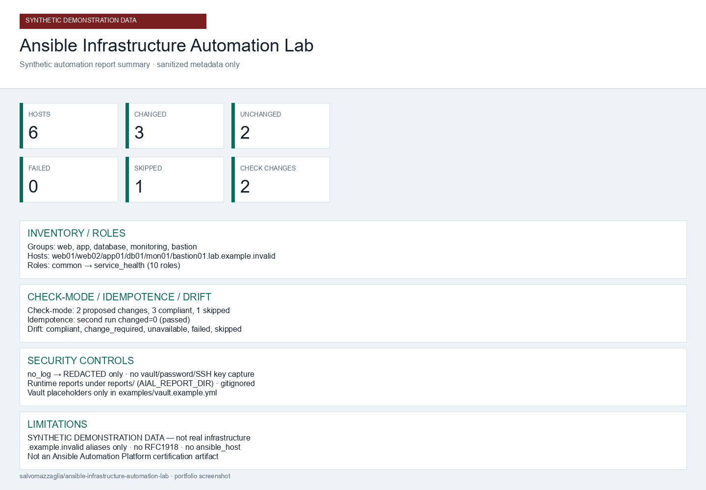

# Ansible Infrastructure Automation Lab

**Professional Ansible collection laboratory for configuration management, reusable roles, multi-host orchestration, check mode, drift detection, and Molecule testing — entirely synthetic.**

[](https://github.com/salvomazzaglia/ansible-infrastructure-automation-lab/actions/workflows/ci.yml)
[](VERSION)
[](LICENSE)
[](docs/compatibility.md)
[](galaxy.yml)

> All inventories, hosts, variables, reports, and infrastructure examples in this repository are synthetic. No real production or homelab inventory is included.

> Public example inventories are intentionally non-routable and are not intended to be used as deployment targets.

> Check mode can reduce deployment risk but does not guarantee that an apply operation will be safe or produce exactly the same result.

> The ansible-lint production profile is used as a repository quality gate. This does not imply Red Hat, Ansible Automation Platform, or Ansible Galaxy certification.



---

## 1. Project title

**ansible-infrastructure-automation-lab** — collection
`salvomazzaglia.infrastructure_automation` by Salvatore Mazzaglia.

## 2. Value proposition

Learn and demonstrate production-minded Ansible practices without pointing at
real machines: role design, inventory hygiene, variable precedence, check
mode, drift collection, rolling updates, handlers, argument specs, vault
placeholders, sanitized reporting, Molecule ephemeral tests, and hardened CI.

## 3. CI badge

Continuous integration runs on GitHub-hosted runners only (see badge above).
Workflow: [`.github/workflows/ci.yml`](.github/workflows/ci.yml). Details:
[`docs/ci.md`](docs/ci.md).

## 4. Version

Current release: **1.0.0** ([`VERSION`](VERSION), [`CHANGELOG.md`](CHANGELOG.md),
[`docs/release-notes-v1.0.0.md`](docs/release-notes-v1.0.0.md)).

## 5. License

Licensed under the [MIT License](LICENSE). Copyright 2026 Salvatore Mazzaglia.

## 6. Ansible

Targets **ansible-core 2.20.7** and **2.21.2** on Python **3.12** / **3.13**
(CI matrix). Runtime metadata: `requires_ansible: ">=2.20.0"`. See
[`docs/compatibility.md`](docs/compatibility.md).

## 7. Screenshot

Synthetic automation report above
(`docs/images/sample-automation-report.png`), generated from demonstration
HTML that includes **SYNTHETIC DEMONSTRATION DATA**.

## 8. Why this project exists

Many Ansible demos either skip safety (real hosts, weak SSH, `latest`
packages) or skip engineering depth (no argument specs, no Molecule, no CI
pins). This lab is a portfolio-ready middle path: realistic roles and
orchestration patterns with an explicit fail-closed safety model.

## 9. Architecture

Control node → collection roles/playbooks/callback → synthetic or Molecule
inventory → optional sanitized JSON reports. Preflight gates every apply path.
Docs: [`docs/architecture.md`](docs/architecture.md).

```text
Playbooks ──► Roles (aial_*) ──► Handlers
    │                │
    └── preflight    └── argument specs
Inventories: synthetic (check-only) | molecule (ephemeral) | private (untracked)
```

## 10. Collection structure

```text
galaxy.yml / meta/runtime.yml
roles/          playbooks/       plugins/callback/
inventories/    molecule/        tests/ + scripts/
docs/           examples/        schemas/
```

Design notes: [`docs/collection-design.md`](docs/collection-design.md).

## 11. Synthetic lab inventory

Six fictional hosts under `inventories/synthetic/`
(`*.lab.example.invalid`), groups `bastion`, `web`, `app`/`application`,
`database`, `monitoring`. No `ansible_host`, no RFC1918, `aial_safe_to_apply:
false`. Docs: [`docs/inventory-model.md`](docs/inventory-model.md),
[`inventories/README.md`](inventories/README.md).

## 12. Roles

Ten roles: `common`, `package_management`, `accounts`, `time_sync`,
`logging`, `ssh_hardening`, `automatic_updates`, `firewall_policy`,
`web_service`, `service_health`. Docs: [`docs/roles.md`](docs/roles.md).

## 13. Playbooks

| Playbook | Intent |
| --- | --- |
| `site.yml` | Full site + rolling web |
| `baseline.yml` | Baseline configuration |
| `security.yml` | SSH / updates / firewall |
| `web.yml` | Serial web rolling |
| `check.yml` | Check-mode preview |
| `drift.yml` | Drift collection |
| `health.yml` | Local health checks |

## 14. Configuration management model

Desired state is expressed as declarative role defaults + inventory overrides
(`aial_` prefix). Variable precedence:
[`docs/variable-precedence.md`](docs/variable-precedence.md). Packages use
present/absent only — never `state: latest`.

## 15. Check mode

`playbooks/check.yml` and `--check --diff` against synthetic inventory are
supported; preflight allows check when apply is gated off. Docs:
[`docs/check-mode.md`](docs/check-mode.md).

## 16. Idempotence

Declarative modules, stable templates, Molecule idempotence steps, and
repository guards against `changed_when: false` abuse. Docs:
[`docs/idempotence.md`](docs/idempotence.md).

## 17. Drift detection

Check-mode drift playbook with documented status vocabulary and sample JSON
schema. Docs: [`docs/drift-detection.md`](docs/drift-detection.md).

## 18. Rolling deployment

`serial: 1` with synthetic LB pool drain/restore state (no real load
balancer). Docs: [`docs/rolling-deployment.md`](docs/rolling-deployment.md).

## 19. Handlers

Roles notify handlers only on real configuration changes (for example SSH
reload, web service restart) after validation commands where applicable.

## 20. Role argument specs

Every role ships `meta/argument_specs.yml` for typed inputs and choices.
Pytest covers argument-spec presence and key variables.

## 21. Secrets / Vault model

Placeholder-only `examples/vault.example.yml`. No vault passwords or real
secrets in git. Docs: [`docs/secrets-and-vault.md`](docs/secrets-and-vault.md).

## 22. Callback reporting

Plugin `salvomazzaglia.infrastructure_automation.automation_report` writes
sanitized JSON under `reports/` (gitignored). Respects `no_log` and redacts
sensitive keys. See [`plugins/README.md`](plugins/README.md).

## 23. Molecule

Scenarios `baseline` and `orchestration` use ephemeral Docker,
digest-pinned images, and ansible-native create/destroy via
`community.docker`. Scenarios are provided and expected to run in CI; claim a
local pass only after you run them. Docs:
[`docs/molecule-testing.md`](docs/molecule-testing.md).

## 24. ansible-lint

`.ansible-lint` uses **profile: production** as a repository quality gate —
not a Red Hat / AAP / Galaxy certification claim.

## 25. Compatibility

Documented pins: ansible-core 2.20.7 & 2.21.2; Python 3.12/3.13; ansible-lint
26.6.0; Molecule 26.6.0; Ubuntu/Debian image digests listed in
[`docs/compatibility.md`](docs/compatibility.md).

## 26. Quick start

```bash
python -m pip install -r requirements-dev.txt
ansible-galaxy collection install -r requirements.yml
python scripts/validate-repository.py
python scripts/run-ci.py
python -m pytest
```

Syntax check against synthetic inventory:

```bash
ansible-playbook --syntax-check \
  -i inventories/synthetic/hosts.yml \
  playbooks/site.yml
```

## 27. Safe check-mode workflow

```bash
ansible-playbook \
  -i inventories/synthetic/hosts.yml \
  --check --diff \
  playbooks/check.yml
```

Or:

```bash
./scripts/check-lab.sh --check \
  --inventory inventories/synthetic
```

## 28. Ephemeral apply workflow

Apply only against Molecule (or an untracked authorized inventory):

```bash
./scripts/run-molecule.sh baseline
./scripts/check-lab.sh --apply   # defaults to molecule/baseline/inventory
```

`./scripts/check-lab.sh --apply` **refuses** `inventories/synthetic`.

## 29. CI

Jobs: lint, core-compatibility matrix, Molecule (Ubuntu + Docker), collection
package artifact. No secrets, no deploy, Actions SHA-pinned. Dependabot:
pip + github-actions weekly.

## 30. Security

Fail-closed apply, inventory hygiene, secrets guards, SSH/firewall lockout
awareness, callback redaction, CI hardening. Docs:
[`docs/safety-model.md`](docs/safety-model.md),
[`docs/threat-model.md`](docs/threat-model.md),
[`docs/security-audit-v1.0.0.md`](docs/security-audit-v1.0.0.md),
[`SECURITY.md`](SECURITY.md).

## 31. Known limitations

- Debian/Ubuntu managed nodes only
- Public inventory cannot and must not be used as an apply target
- No real LB, cloud inventory, AWX/AAP, or Galaxy publish in v1.0
- Check mode is advisory
- Molecule requires Docker when executed

## 32. Roadmap

Future only (not implemented in v1.0):

- Red Hat / Rocky Linux targets
- Windows managed nodes
- Proxmox inventory plugin
- Cloud dynamic inventory
- AWX
- Ansible Automation Platform
- GitHub OIDC for cloud automation
- Secret manager integrations
- HashiCorp Vault
- Real load-balancer adapters
- Network-device automation
- Kubernetes
- Collection publication to Galaxy

## 33. Skills demonstrated

- Ansible
- Configuration Management
- Infrastructure as Code
- Linux System Administration
- Infrastructure Automation
- YAML
- Jinja2
- Ansible Collections
- Ansible Roles
- Inventory Management
- Variable Management
- Idempotence
- Check Mode
- Molecule
- ansible-lint
- ansible-test
- Linux Security
- SSH
- Service Management
- Package Management
- Rolling Deployment
- GitHub Actions
- CI/CD
- DevOps
- Technical Documentation

## 34. Contributing

Please read [`CONTRIBUTING.md`](CONTRIBUTING.md). Pull requests that include
real infrastructure data or disable safety gates will be rejected.

## 35. License

[MIT](LICENSE) © 2026 Salvatore Mazzaglia.

## 36. Author

**Salvatore Mazzaglia** — GitHub: [salvomazzaglia](https://github.com/salvomazzaglia)

Repository: https://github.com/salvomazzaglia/ansible-infrastructure-automation-lab

---

## Documentation index

| Doc | Topic |
| --- | --- |
| [architecture.md](docs/architecture.md) | System layers |
| [collection-design.md](docs/collection-design.md) | Collection layout |
| [inventory-model.md](docs/inventory-model.md) | Synthetic inventory |
| [variable-precedence.md](docs/variable-precedence.md) | Variables |
| [roles.md](docs/roles.md) | Role catalog |
| [idempotence.md](docs/idempotence.md) | Idempotence |
| [check-mode.md](docs/check-mode.md) | Check mode |
| [drift-detection.md](docs/drift-detection.md) | Drift |
| [secrets-and-vault.md](docs/secrets-and-vault.md) | Vault placeholders |
| [ssh-hardening.md](docs/ssh-hardening.md) | SSH role |
| [firewall-policy.md](docs/firewall-policy.md) | Firewall role |
| [rolling-deployment.md](docs/rolling-deployment.md) | Serial web |
| [molecule-testing.md](docs/molecule-testing.md) | Molecule |
| [ci.md](docs/ci.md) | GitHub Actions |
| [safety-model.md](docs/safety-model.md) | Safety controls |
| [threat-model.md](docs/threat-model.md) | Threats |
| [compatibility.md](docs/compatibility.md) | Version matrix |
| [development-plan.md](docs/development-plan.md) | Phases |
| [release-notes-v1.0.0.md](docs/release-notes-v1.0.0.md) | Release notes |
| [security-audit-v1.0.0.md](docs/security-audit-v1.0.0.md) | Audit |
